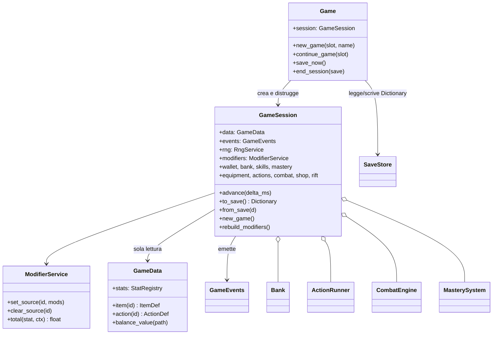
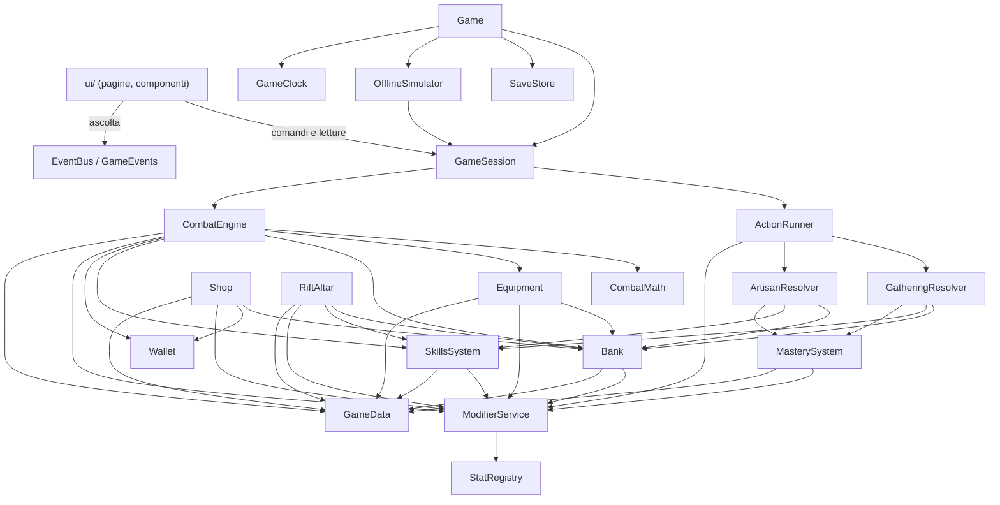
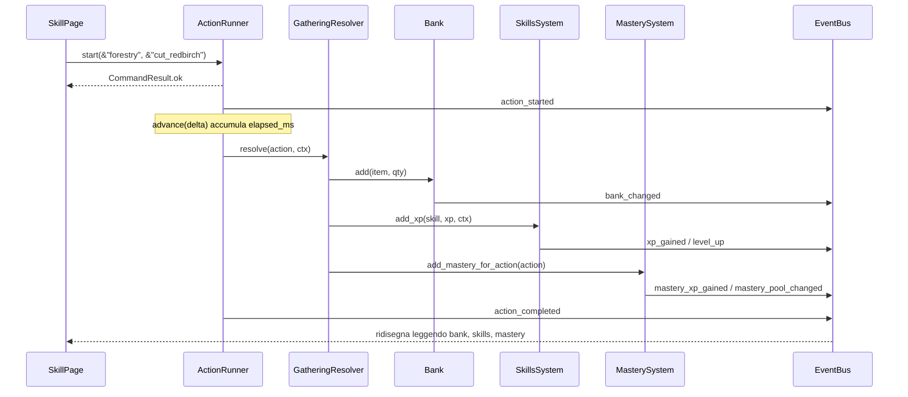
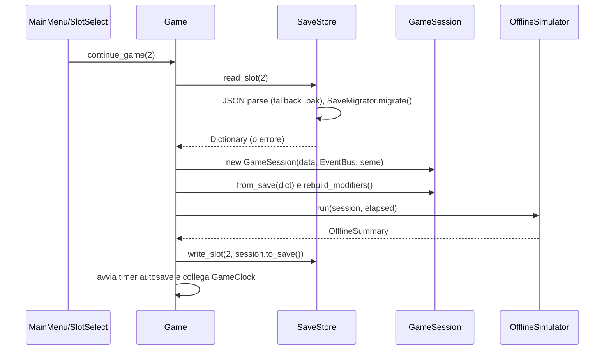
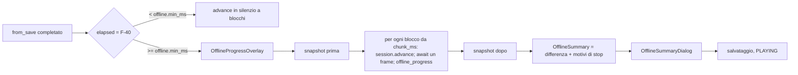
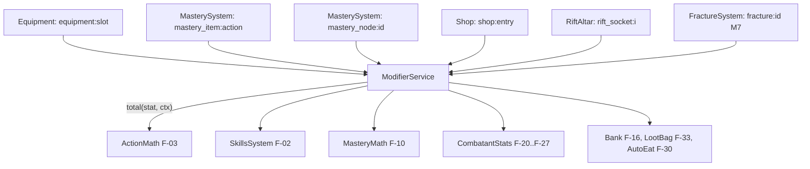

# 03. Architettura

Godot **4.5 stable**, GDScript con tipizzazione statica ovunque, renderer **GL Compatibility** (gioco solo UI).
Le firme esatte di classi, metodi e segnali sono in `05_INTERFACES.md`: questo documento spiega **come** i pezzi stanno
insieme e **perché**.

## 1. Principi

1. **Logica e UI separate.** Tutta la logica sta in classi `RefCounted` sotto `res://core/` e `res://systems/`, senza
   nodi della scena, senza `get_node`, testabili da sole. La UI (`res://ui/`) legge lo stato e manda comandi.
2. **Una sessione per slot.** Lo stato di una partita vive in un oggetto `GameSession` creato quando il giocatore sceglie
   uno slot e distrutto quando lo lascia. Nessuno stato di gioco negli autoload.
3. **Dati fuori dal codice.** Contenuti e parametri in JSON sotto `res://data/`, caricati in classi `*Def` tipizzate e
   validati all'avvio; un errore nei dati è un errore visibile, mai un valore inventato.
4. **Un solo sistema di modificatori** (`ModifierService`), usato da tutte le formule.
5. **Tempo a passi fissi e deterministico**: stesso seme + stessa sequenza di comandi = stesso risultato, online o offline.
6. **File piccoli**: nessuno script o scena oltre ~400 righe.

## 2. Struttura delle cartelle (`res://`)

```text
res://
├── project.godot                 ← creato in M0 (task M0-01)
├── CLAUDE.md
├── .gutconfig.json  .gitignore  .gitattributes  .editorconfig  icon.svg
├── docs/                         ← questa documentazione
├── .claude/agents/               ← un file per ruolo (08_TEAM.md)
├── addons/gut/                   ← GUT 9.5.0, mai modificato
├── core/
│   ├── autoload/                 ← log.gd, event_bus.gd, data_registry.gd, game_clock.gd, save_service.gd, game.gd
│   ├── common/                   ← command_result.gd, reasons.gd
│   ├── data/                     ← game_data.gd, json_loader.gd, data_validator.gd
│   │   └── defs/                 ← item_def.gd, skill_def.gd, action_def.gd, monster_def.gd, area_def.gd,
│   │                               shop_entry_def.gd, mastery_node_def.gd, item_qty.gd, drop_entry.gd, fracture_def.gd (M7)
│   ├── modifiers/                ← modifier.gd, modifier_context.gd, modifier_service.gd, stat_registry.gd
│   ├── progression/              ← xp_table.gd
│   ├── session/                  ← game_session.gd, rng_service.gd, session_snapshot.gd
│   ├── save/                     ← save_codec.gd, save_migrator.gd, slot_info.gd, migrations/
│   ├── offline/                  ← offline_simulator.gd, offline_summary.gd
│   └── settings/                 ← game_settings.gd
├── systems/
│   ├── wallet/                   ← wallet.gd
│   ├── bank/                     ← bank.gd
│   ├── skills/                   ← skills_system.gd
│   ├── mastery/                  ← mastery_system.gd, mastery_math.gd
│   ├── actions/                  ← action_runner.gd, action_math.gd, action_outcome.gd,
│   │                               gathering_resolver.gd, artisan_resolver.gd
│   ├── equipment/                ← equipment.gd
│   ├── combat/                   ← combat_engine.gd, combat_math.gd, combatant_stats.gd, auto_eat.gd, loot_bag.gd
│   ├── shop/                     ← shop.gd
│   ├── rift/                     ← rift_altar.gd
│   ├── hints/                    ← hints_system.gd (M6)
│   └── fractures/                ← fracture_system.gd (M7)
├── data/
│   ├── config/                   ← balance.json, stats.json
│   ├── skills/skills.json
│   ├── items/                    ← materials.json, equipment.json, tools.json, food.json, infusions.json, misc.json
│   ├── actions/<skill>.json      ← una per skill non di combattimento (7 file)
│   ├── mastery/<skill>.json      ← nodi della maestria (7 file)
│   ├── combat/                   ← areas.json, monsters.json
│   ├── shop/shop.json
│   ├── hints/hints.json          (M6)
│   └── fractures/fractures.json  (M7)
├── ui/
│   ├── theme/                    ← ui_style.gd, riftstone_idle_theme.tres (generato)
│   ├── components/               ← game_window/, tooltip/, toast/, item_slot/, progress/, confirm_dialog/
│   ├── screens/                  ← main_menu/, slot_select/, main/ (main_screen, sidebar, top_bar, page_host), offline/
│   ├── pages/                    ← skill/, bank/, shop/, equipment/, combat/, rift/, mastery/
│   ├── settings/                 ← settings_panel
│   └── feedback/                 ← level_up_banner, shard_burst
├── assets/
│   ├── fonts/                    ← Cinzel, Alegreya Sans + licenze OFL
│   ├── icons/ui/                 ← icone Tabler (MIT) + licenza
│   ├── icons/items/  icons/skills/  icons/monsters/
│   ├── ui/frames/                ← cornici 9-slice
│   └── audio/
├── tools/                        ← build_ui_theme.gd, validate_data.gd, check_file_sizes.gd,
│                                   check_forbidden_refs.gd, run_tests.ps1, run_checks.ps1, ui_shots/ (M6)
└── tests/                        ← specchio di core/ e systems/
    ├── helpers/                  ← gut_pre_run.gd, test_factory.gd
    ├── fixtures/data/            ← set di dati minimo e stabile per i test (stessa struttura di res://data)
    ├── core/…  systems/…         ← test unitari, stessa struttura delle cartelle sorgente
    ├── data/                     ← validità dei dati veri (test_data_validity.gd)
    ├── integration/              ← flussi completi su GameSession
    └── ui/                       ← smoke test delle scene (si istanziano senza errori)
```

Regole: le scene `.tscn` stanno **accanto** al loro script, nella stessa cartella. Nomi dei file in `snake_case`.
La sottocartella `rifstone-saga---melvor/` creata dall'editor va rimossa in M0-01 (con conferma dell'utente).

## 3. Autoload

Ordine in `project.godot` (solo servizi senza stato di gioco):

| Nome autoload | Script | `class_name` | Ruolo |
|---|---|---|---|
| `Log` | `core/autoload/log.gd` | — | log con livelli (`debug/info/warn/error`), senza emoji; l'unico che chiama `print` |
| `EventBus` | `core/autoload/event_bus.gd` | `GameEvents` | **solo segnali**, nessuno stato; elenco in `05_INTERFACES.md` §3 |
| `DataRegistry` | `core/autoload/data_registry.gd` | — | carica e tiene un `GameData` (dati in sola lettura) |
| `GameClock` | `core/autoload/game_clock.gd` | — | trasforma il tempo reale in passi da `tick_ms`, segnale `ticked(delta_ms)` |
| `SaveService` | `core/autoload/save_service.gd` | `SaveStore` | legge/scrive i file degli slot, versioni e migrazioni; non conosce i sistemi |
| `Game` | `core/autoload/game.gd` | — | coordinatore: crea/chiude la `GameSession`, autosave, offline, collegamento al clock |
| `Tooltips` | `ui/components/tooltip/tooltip_manager.gd` | — | tooltip unico su un `CanvasLayer` (porting da RiftStone) |

`class_name` diverso dal nome dell'autoload (Godot non accetta lo stesso nome): così i test possono creare istanze
proprie (`GameEvents.new()`, `SaveStore.new()`) senza toccare gli autoload.

## 4. Classi core



- `GameSession` **estende `Node`** (non entra nell'albero; la crea e la libera `Game`). I sistemi sono `RefCounted` e
  tengono un riferimento alla sessione: siccome la sessione non è a conteggio di riferimenti, non ci sono cicli che
  impediscono di liberare la memoria. `end_session` chiama `session.free()`.
- Ogni sistema riceve la sessione nel costruttore e usa **solo** i fratelli elencati come dipendenze in
  `05_INTERFACES.md`. Gli eventi si emettono su `session.events` (nei test è un `GameEvents` nuovo, non l'autoload).
- `GameData` è immutabile dopo il caricamento. I sistemi non lo modificano mai.

### 4.1 Dipendenze tra moduli (nessun ciclo)



Regola: i sistemi "foglia" (`Wallet`, `Bank`, `SkillsSystem`, `MasterySystem`, `ModifierService`) non conoscono
azioni, combattimento o UI. `ActionRunner` e `CombatEngine` orchestrano. La UI non è mai chiamata dalla logica.

## 5. Comandi, letture, segnali

- **Comandi** (UI → logica): metodi pubblici dei sistemi che restituiscono `CommandResult` (`ok`, `reason`).
  Esempi: `session.actions.start(&"forestry", &"cut_redbirch")`, `session.shop.buy(&"bank_slot")`.
  Un comando non valido non cambia nulla e dà un `reason` da `Reasons` (elenco chiuso in `05_INTERFACES.md`).
- **Letture** (UI → logica): getter puri (`bank.get_count(id)`, `actions.get_progress(&"main")`). La UI **non tiene
  copie** dei dati: ridisegna leggendo dopo un segnale, o ogni frame per le barre di progresso.
- **Segnali** (logica → UI): `EventBus` con parametri tipizzati. I segnali descrivono ciò che è già successo.



## 6. Tick

- `GameClock._process(delta)` accumula millisecondi reali e, per ogni `tick_ms` (100) intero accumulato, emette
  `ticked(tick_ms)`; massimo `max_catchup_ms` per frame (il resto si scarta). `set_paused(true)` durante menu e offline.
- `Game` collega `GameClock.ticked` a `session.advance(delta_ms)` solo quando la sessione è in stato `PLAYING`.
- `GameSession.advance(delta_ms)` chiama in ordine fisso: `fractures.advance` (M7) → `actions.advance` → `combat.advance`
  → `play_time_ms += delta_ms`.
- Ogni `advance` gestisce **più eventi nello stesso passo** (es. due cicli d'azione da 250 ms in 600 ms): è la
  condizione che rende identici online e offline (test di equivalenza F-41).
- Nessun sistema usa `_process`, `Timer` o `await` per la logica. Fanno eccezione solo `GameClock` e la UI.

## 7. Salvataggio e caricamento per slot



- **Nessun salvataggio senza slot.** `Game.save_now()` restituisce `slot_not_selected` se `session == null`; il timer
  dell'autosave esiste solo dentro `new_game`/`continue_game` e si ferma in `end_session`. `SaveStore` non scrive mai
  da solo. Test dedicato: `tests/core/autoload/test_game_no_save_before_slot.gd`.
- **Formato**: un file JSON per slot, `user://saves/slot_<n>.json` (formato completo in `05_INTERFACES.md` §6).
  Ogni sistema scrive il proprio blocco in `modules.<chiave>` con `to_save()` e lo legge con `from_save()`.
- **Versioni**: `format_version` intero; `SaveMigrator.CURRENT_VERSION` è l'unica definizione. Migrazioni in
  `core/save/migrations/migration_<da>_to_<a>.gd` (una funzione statica `migrate(d: Dictionary) -> Dictionary`),
  applicate in catena. File più nuovo del gioco → `version_unsupported`.
- **Scrittura atomica**: scrive `slot_<n>.json.tmp`, poi sposta il file attuale in `slot_<n>.json.bak` e rinomina il
  temporaneo. In lettura, se il file principale non è valido si prova il `.bak` (ma un file valido con versione più
  nuova non viene mai sostituito dal `.bak`). La scrittura è sincrona (file piccoli, < 200 KB): misurata in M1-06
  (`test_write_200_kb_and_measure`), 200 KB scritti in ~10-12 ms, quindi niente thread (Q5 confermato col default);
  il test segnala con un warning se si superano 30 ms.
- **Stato derivato non salvato**: livelli, modificatori, capienze, statistiche di combattimento si ricalcolano.
- **Isolamento**: caricare lo slot B dopo lo slot A crea una `GameSession` nuova; niente sopravvive tra slot
  (test `tests/integration/test_slot_isolation.gd`).

## 8. Calcolo offline



- `OfflineSimulator` usa lo **stesso** `session.advance`: nessuna formula duplicata per l'offline.
- I sistemi raccolgono contatori di sessione che servono al riepilogo (uccisioni, morti, cibo mangiato, motivi di
  stop) in `SessionSnapshot`; la differenza tra due snapshot dà il riepilogo.
- Durante la simulazione `GameClock` è in pausa e la UI non accetta comandi (overlay modale).

## 9. Sistema unico di modificatori



- Un **modificatore** è `{stat, value, scope}`. Le sorgenti si registrano con `set_source(source_id, mods)`: chiamarlo
  di nuovo con lo stesso id **sostituisce** (non somma), quindi la doppia applicazione è impossibile per costruzione.
- `total(stat, ctx)` somma i valori applicabili e limita il totale con `min/max` di `stats.json` (F-05).
- Ogni sistema proprietario di una sorgente ha `rebuild_modifiers()`; `GameSession.rebuild_modifiers()` chiama
  `modifiers.clear_all()` e poi tutti i `rebuild_modifiers()`. Si chiama dopo `from_save` e `new_game`.
- La validazione dei dati rifiuta modificatori su stat non registrate.
- Cache: `total` può tenere una cache per `(stat, ctx)` invalidata a ogni `set_source/clear_source`.

## 10. Dati

- JSON sotto `res://data/`; `JsonLoader` legge i file, `DataValidator` controlla schema e riferimenti incrociati
  (id esistenti, stat registrate, livelli 1-99, quantità > 0), `GameData` costruisce i `*Def`.
- Con dati non validi `GameData.is_valid()` è falso e `errors` elenca i problemi; il gioco mostra un errore e non entra
  in partita; `tools/validate_data.gd` li stampa da riga di comando. Nessun fallback.
- Schema di ogni tipo: `04_DATA_SCHEMA.md`.

## 11. UI

- `ui/screens/main_menu` è la scena principale. Dopo la scelta dello slot si passa a `ui/screens/main/main_screen.tscn`:
  barra in alto (oro, caselle della bank, nome dello slot, menu), **sidebar** a sinistra (skill con livello,
  Bank, Shop, Equipaggiamento, Combattimento, Altare del Rift, Impostazioni), area centrale `PageHost`.
- `PageHost` istanzia la pagina richiesta (`&"skill:forestry"`, `&"bank"`…) e chiama `bind(session)`; cambiando pagina
  chiama `unbind()` e la libera. Le pagine si collegano all'`EventBus` in `bind` e si scollegano in `unbind`.
- Una sola `SkillPage` generica disegna tutte le skill di raccolta e artigianato leggendo i dati (niente scena per skill).
- Risoluzione base 1600×900, minimo 1280×720; scala UI dalle impostazioni.
- Tema: `ui/theme/ui_style.gd` (porting di `UiStyle` di RiftStone) genera `riftstone_idle_theme.tres`.

## 12. Come l'architettura rispetta le Lezioni da RiftStone

| Lezione | Come la rispettiamo | Verifica |
|---|---|---|
| **Niente god object** | Ogni dominio ha un modulo: `Wallet`, `Bank`, `SkillsSystem`, `MasterySystem`, `Equipment`, `ActionRunner`, `CombatEngine`, `Shop`, `RiftAltar`; salvataggio in `SaveStore`, coordinamento in `Game`. `GameSession` contiene solo riferimenti e `advance/to_save/from_save` (≤ 200 righe) | revisione (M*-REV), `tools/check_file_sizes.gd` |
| **Unica fonte di verità** | Gli oggetti posseduti stanno solo in `Bank` (più equip indossato, borsa del bottino, prese: un pezzo è sempre in un solo posto). Il cibo scelto è un riferimento alla bank. La UI non ha variabili di stato di gioco: legge con i getter dopo i segnali | test di integrazione "conservazione degli oggetti"; regola di revisione "nessuna var di stato nella UI" |
| **Nessuna stat decorativa** | `stats.json` elenca ogni stat con formula e test; `DataValidator` rifiuta stat sconosciute; la UI mostra solo stat del registro | `tests/data/test_stat_registry_coverage.gd` controlla che ogni stat abbia un test che esiste |
| **Tutto per slot** | Tutto lo stato del giocatore è in `GameSession` e nel file dello slot (anche stance, cibo scelto, azione in corso, suggerimenti). Fuori dallo slot solo le impostazioni, che non sono stato di gioco | `test_slot_isolation.gd` |
| **Nessun salvataggio prima dello slot** | Niente sessione = niente salvataggio; autosave creato solo all'ingresso in partita | `test_game_no_save_before_slot.gd` |
| **Un solo sistema di modificatori** | `ModifierService` con sorgenti sostituibili; tutte le formule leggono `total()`; vietati campi "bonus" paralleli nei sistemi | revisione + test F-05 |
| **Parametri con unica definizione** | Numeri di design solo in `balance.json`/`stats.json`/dati; i limiti delle stat solo in `stats.json`; costanti di presentazione solo in `ui_style.gd`. Il codice non contiene numeri di bilanciamento | voce "numeri di design nel codice" della lista di revisione (`09_CONVENTIONS.md` §9); test dei dati che leggono i valori da `balance.json` |
| **File ≤ ~400 righe** | Moduli già divisi (es. combattimento in 5 file); i task indicano i file da produrre | `tools/check_file_sizes.gd` in `run_checks.ps1` (fallisce oltre 400) |

Altri problemi di RiftStone evitati per design: niente percorsi di nodi tra scene (`get_node("/root/...")` vietato
fuori dagli autoload, la UI riceve la sessione con `bind`); niente riparenting a runtime; niente doppi id
(`id` ovunque, mai `item_id` e `id` insieme); enum salvati come stringhe, mai come interi; niente `print` (solo `Log`);
fine riga LF ovunque; un solo sistema di "potenziamento" (i modificatori).

## 13. Moduli portati da RiftStone

Solo il Porting Engineer legge `../RIFTSTONE SAGA/`. Il codice viene **copiato** e adattato; nessun percorso del
nuovo progetto punta alla cartella di RiftStone.

| Sorgente (`../RIFTSTONE SAGA/`) | Destinazione (`res://`) | Refactor necessario | Task |
|---|---|---|---|
| `addons/gut/` (9.5.0) | `addons/gut/` | nessuno (copia intera) | M0-02 |
| `scripts/ui/theme/UiStyle.gd` | `ui/theme/ui_style.gd` | `snake_case` del file; percorsi asset verso `res://assets/...` nuovi; `THEME_PATH` = `res://ui/theme/riftstone_idle_theme.tres`; tipizzazione completa; aggiungere le costanti di presentazione (toast, banner) | M0-04 |
| `tools/build_ui_theme.gd` | `tools/build_ui_theme.gd` | nuovi percorsi | M0-04 |
| `assets/ui/frame_*.png` | `assets/ui/frames/` | nessuno | M0-04 |
| `assets/fonts/*` (+ `OFL-*.txt`) | `assets/fonts/` | nessuno; licenze copiate | M0-04 |
| `assets/ui/icons/` (+ `LICENSE-tabler.txt`) | `assets/icons/ui/` | solo le icone usate più la licenza | M0-04 |
| `scripts/ui/hud/GameWindow.gd` | `ui/components/game_window/game_window.gd` | `snake_case`; testi in `@export`; tipizzazione | M1-16 |
| `scripts/ui/TooltipManager.gd`, `scripts/ui/CustomTooltip.gd`, `scenes/ui/CustomTooltip.tscn` | `ui/components/tooltip/` | togliere l'accesso a `/root/GameState`; ricevere `ItemDef` + quantità invece di dizionari; mostrare i modificatori leggendo `StatRegistry` per le etichette | M1-15 |
| `scripts/ui/LootNotificationManager.gd`, `LootNotification.gd`, `scenes/ui/LootNotification.tscn` | `ui/components/toast/` | da "chiamato da tutti" a "ascolta EventBus"; raggruppamento 1 s; tipi `info/success/warning` | M1-16 |
| `scripts/systems/Shop.gd` | `systems/shop/shop.gd` | da classe statica con JSON proprio a sistema della sessione che usa `GameData`; prezzi e valori solo dai dati (eliminata la regola "60 × livello" scritta nel codice); acquisti, requisiti, modificatori, F-17 | M3-02 |
| `scripts/systems/GameSettings.gd` | `core/settings/game_settings.gd` | togliere qualità 3D/supersampling; aggiungere livello dei log; tipizzazione | M6-03 |
| `scripts/ui/SettingsPanel.gd` | `ui/settings/settings_panel.gd` | togliere `GameState`; "Salva ed esci" chiama `Game.end_session(true)`; niente "rivedi suggerimenti" globale (è per slot) | M6-03 |

Idee riprese senza copiare codice (le scrive chi implementa, leggendo solo questi documenti): scrittura del salvataggio
con flush prima della chiusura; tabella dei drop `{item, chance}`; razioni da campo (da `AutoPotion`); suggerimenti
una volta sola (da `TesterHints`, ma per slot); log a livelli; foto automatiche della UI (`tools/UiShots`); hook GUT
che isola i salvataggi dei test.
