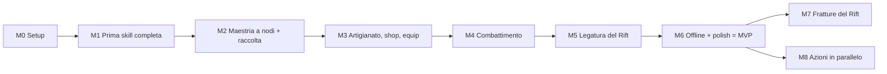

# 06. Roadmap

Milestone incrementali: alla fine di ognuna il gioco si avvia, è giocabile per quello che contiene e tutti i test
passano (`tools/run_checks.ps1` verde). L'MVP è M0-M6; M7 e M8 vengono dopo. Il dettaglio dei task è in `07_TASKS.md`.

## M0: Setup del progetto
**Obiettivo**: progetto Godot 4.5 vuoto ma strutturato, test e controlli che girano.
**Contenuto**: pulizia della root (rimozione della sottocartella `rifstone-saga---melvor/` con conferma dell'utente),
`project.godot` (GL Compatibility, finestra 1600×900, minimo 1280×720), struttura delle cartelle, git, GUT 9.5.0,
autoload con le firme definitive (EventBus completo, Log, GameClock; stub per DataRegistry, SaveService, Game), tema
base portato da RiftStone, `balance.json` e `stats.json`, menu segnaposto, script di test e di controllo.
**Giocabile**: si apre la finestra con il menu nello stile D; "Esci" funziona.
**Uscita**: `tools/run_checks.ps1` verde (test, dimensione dei file, nessun riferimento a RiftStone).

## M1: Prima skill completa (Selvicoltura)
**Obiettivo**: il ciclo base end-to-end su una skill.
**Contenuto**: tabella XP, modificatori, livello dati con validazione, sessione, salvataggio per slot con versioni,
Wallet, Bank, Skill, maestria per oggetto e pool (senza nodi), ActionRunner e raccolta, `Game` vero (menu → slot →
partita → salvataggio), contenuto di Selvicoltura (8 azioni) e definizione delle 12 skill, menu e scelta dello slot,
schermata principale (sidebar, barra in alto, pagine), pagina skill, bank minima, tooltip e toast portati.
**Giocabile**: nuova partita in uno slot, taglio della legna, XP e livelli, maestria per oggetto, oggetti nella bank,
uscita e rientro con il progresso intatto, slot separati.

## M2: Maestria a nodi e altre due skill di raccolta
**Contenuto**: nodi della maestria e spesa del pool; Cavatura e Lenza (8 azioni ciascuna); nodi delle 3 skill di
raccolta; pannello della maestria; bank completa (blocco, ordinamento, spostamento, pannello dell'oggetto).
**Giocabile**: tre skill di raccolta, alberi dei nodi, gestione della bank.

## M3: Artigianato, shop, equipaggiamento
**Contenuto**: risoluzione delle ricette (ingredienti, conservazione); Forgiatura, Focolare, Intaglio; shop portato da
RiftStone (caselle della bank, attrezzi, razioni da campo come voce già acquistabile); equipaggiamento e attrezzi;
pagine shop ed equipaggiamento; vendita dalla bank.
**Giocabile**: catena raccolta → artigianato → attrezzi che accelerano la raccolta; economia con oro.

## M4: Combattimento
**Contenuto**: formule di combattimento, statistiche dei combattenti, razioni da campo, borsa del bottino, motore del
combattimento; 4 aree e 12 mostri; pagina del combattimento.
**Giocabile**: duelli automatici con i 3 stili e il triangolo, cibo, morte, bottino; equip forgiato usato davvero.

## M5: Legatura del Rift
**Contenuto**: Altare del Rift (5 prese), ricette delle infusioni, nodi della maestria delle 4 skill di artigianato,
pagina dell'Altare.
**Giocabile**: frammenti da raccolta e mostri, infusioni incastonate che cambiano davvero i numeri.

## M6: Offline e polish (fine dell'MVP)
**Contenuto**: simulazione offline fino a 12 ore con riepilogo; impostazioni portate da RiftStone; suggerimenti per
slot; feedback visivo (banner, particelle, numeri del danno); regressione completa, prestazioni, foto automatiche
della UI; preset di esportazione Windows e checklist di rilascio.
**Giocabile**: l'MVP completo. **Uscita**: tutti i test (incluso il controllo di copertura delle stat in modalità
rigida) verdi; 12 ore di offline simulate in meno di 10 s.

## M7: Fratture del Rift (dopo l'MVP)
Sistema delle Fratture, dati, indicatore nella UI. **Giocabile**: finestre a tempo con bonus e mostri speciali.

## M8: Azioni in parallelo (dopo l'MVP)
Corsia secondaria nell'ActionRunner, voce dello shop "Secondo pensiero", UI a due corsie.
**Giocabile**: una skill non di combattimento in parallelo al combattimento o a un'altra skill.

## Percorso critico e parallelismo
- Percorso critico: M0-01 → M0-03 → M1-02 → M1-03 → M1-04 → M1-05 → M1-07 → M1-10 → M1-11 → M1-13 → M1-20 → …
- Si possono anticipare: M4-01 (formule di combattimento, dipende solo da M1-04), M1-06 (salvataggio), M1-16/M1-17
  (porting UI), i task DATA appena esiste lo schema validato (M1-04).
