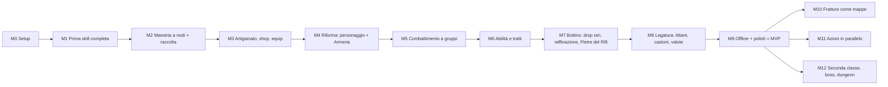

# 06. Roadmap

Milestone incrementali: alla fine di ognuna il gioco si avvia, è giocabile per quello che contiene e tutti i test
passano (`tools/run_checks.ps1` verde). L'MVP è M0-M9; M10-M12 vengono dopo. Il dettaglio dei task è in `07_TASKS.md`.
Da M4 vale la direzione "combattimento al centro" (decisioni D1-D6, `DECISIONS_LOG.md`); M0-M3 restano valide.

## M0: Setup del progetto
**Obiettivo**: progetto Godot 4.5 vuoto ma strutturato, test e controlli che girano.
**Contenuto**: pulizia della root (rimozione della sottocartella `rifstone-saga---melvor/` con conferma dell'utente),
`project.godot` (GL Compatibility, finestra 1600×900, minimo 1280×720), struttura delle cartelle, git, GUT 9.5.0,
autoload con le firme definitive (EventBus completo, Log, GameClock; stub per DataRegistry, SaveService, Game), tema
base portato da RiftStone, `balance.json` e `stats.json`, menu segnaposto, script di test e di controllo.
**Giocabile**: si apre la finestra con il menu nello stile D; "Esci" funziona.
**Uscita**: `tools/run_checks.ps1` verde (test, dimensione dei file, nessun riferimento a RiftStone).

## M1: Prima skill completa (Selvicoltura)
**Obiettivo**: il ciclo base end-to-end su una skill.
**Contenuto**: tabella XP, modificatori, livello dati con validazione, sessione, salvataggio per slot con versioni,
Wallet, Bank, Skill, maestria per oggetto e pool (senza nodi), ActionRunner e raccolta, `Game` vero (menu → slot →
partita → salvataggio), contenuto di Selvicoltura (8 azioni) e definizione delle 12 skill (ridotte a 7 in M4, D3), menu e scelta dello slot,
schermata principale (sidebar, barra in alto, pagine), pagina skill, bank minima, tooltip e toast portati.
**Giocabile**: nuova partita in uno slot, taglio della legna, XP e livelli, maestria per oggetto, oggetti nella bank,
uscita e rientro con il progresso intatto, slot separati.

## M2: Maestria a nodi e altre due skill di raccolta
**Contenuto**: nodi della maestria e spesa del pool; Cavatura e Lenza (8 azioni ciascuna); nodi delle 3 skill di
raccolta; pannello della maestria; bank completa (blocco, ordinamento, spostamento, pannello dell'oggetto).
**Giocabile**: tre skill di raccolta, alberi dei nodi, gestione della bank.

## M3: Artigianato, shop, equipaggiamento
**Contenuto**: risoluzione delle ricette (ingredienti, conservazione); Forgiatura, Focolare, Intaglio; shop portato da
RiftStone (caselle della bank, attrezzi, razioni da campo come voce già acquistabile); equipaggiamento e attrezzi;
pagine shop ed equipaggiamento; vendita dalla bank.
**Giocabile**: catena raccolta → artigianato → attrezzi che accelerano la raccolta; economia con oro.

## M4: Riforma (personaggio e Armeria)
**Obiettivo**: portare il gioco di M3 sulla nuova direzione senza ancora il combattimento.
**Contenuto**: R-00 (documenti); schema e validatore della riforma (classi, affissi, `kind` e `grade` dei pezzi,
requisiti `character`, gruppi delle aree); 5 skill di combattimento e stance tolte; modulo `character` (livello, XP,
classe unica, senza tratti); salvataggio v2; ItemRoller (rarità F-83, affissi F-85) e Armeria (istanze, `uid`,
capienza F-82, blocco, vendita); equipaggiamento con `uid`, tipi d'arma e assetti (spadone, spada e scudo, due spade);
Forgiatura e Intaglio adeguati (spade, spadoni, scudi, impugnature, anime, manici); UI: pagina Armeria, pagina del
personaggio, equipaggiamento, bank e shop adeguati, sidebar senza skill di combattimento.
**Giocabile**: il gioco di M3 con pezzi forgiati unici (comuni, magici, rari con affissi), Armeria, tre assetti
equipaggiabili e pagina del personaggio (livello 1: l'XP arriva con M5). Un save v1 appare "versione non supportata".

## M5: Combattimento a gruppi
**Contenuto**: formule F-20…F-27 sulla base F-70, F-73…F-77; statistiche dei combattenti (per mano con due spade),
parata, razioni da campo, borsa del bottino; motore a eventi con incontri e gruppi, bersagli, XP per uccisione, morte;
4 aree, 12 mostri, gruppi; pagina del combattimento; `tools/sim_combat.gd`.
**Giocabile**: combattimento automatico a gruppi con attacco base e i tre assetti, XP del personaggio, cibo, morte,
bottino; il triangolo contro i mostri arcani e arcieri.

## M6: Abilità e tratti
**Contenuto**: agganci del motore e 8 tipi di effetto (F-81); abilità (F-79, F-80); `Loadout` con slot (F-78); 12
tratti e 6 abilità della classe (2 per assetto); UI di scelta nella pagina del personaggio e abilità/tratti nella
pagina del combattimento.
**Giocabile**: build vere: i tratti cambiano come si combatte, ogni assetto ha le sue abilità.

## M7: Bottino
**Contenuto**: drop di equipaggiamento con rarità (F-84); anelli e amuleti; raffinazione (F-86); smantellamento (F-88)
e filtro automatico; Pietre del Rift (F-87); UI dell'Armeria completa.
**Giocabile**: caccia al drop e potenziamento a rischio.
**Misure di riferimento** (`tools/sim_combat.gd loot=1 loadout=auto`, set del grado dell'area, seme 1234; criteri
fissati in M7-08, non vincolanti come le formule): 0 morti/ora; 6-18 pezzi/ora (misurati 11,6-17,7 sull'area intera);
un pezzo raro ogni 2-5 ore (misurati 0,08-0,58/ora sull'area intera, 12 h; Bosco il più basso, follow-up di
bilanciamento non bloccante); scontro con la Pietra di 45-80 s con il 20-35% dei PV persi (misurati 46-77 s, 18-34%);
un Sigillo di salvaguardia ogni 3-5 ore di caccia (Pianure circa 1,8 h, Bosco 2,9, Miniere 3,4, Soglia 3); i tre assetti
entro ±30% di uccisioni/ora (misurati da -29% a +27% sullo scudo). Frequenza delle Pietre (Q46, per area): circa 1 Pietra/h in ogni area (misurate 1,13 / 1,00 / 1,00 / 0,96 su 48 h).

## M8: Legatura del Rift
**Contenuto**: Altare del Rift (5 prese) e infusioni; nodi della maestria delle 4 skill di artigianato; castoni (F-89),
pietre incastonabili e tre valute del Rift; pagine dell'Altare e dei castoni.
**Giocabile**: frammenti da raccolta, mostri e Pietre trasformati in infusioni, pietre e crafting degli affissi.

## M9: Offline e polish (fine dell'MVP)
**Contenuto**: simulazione offline fino a 12 ore con il motore a eventi e il filtro, con riepilogo; impostazioni portate
da RiftStone; suggerimenti per slot; feedback visivo (banner, particelle, numeri del danno); regressione completa,
prestazioni, foto automatiche della UI; preset di esportazione Windows e checklist di rilascio.
**Giocabile**: l'MVP completo. **Uscita**: tutti i test (incluso il controllo di copertura delle stat in modalità
rigida) verdi; 12 ore di offline con gruppi da 6 simulate in meno di 10 s.

## M10: Fratture come mappe (dopo l'MVP)
Fratture del Rift ripensate come "mappe" con modificatori (`01_GDD.md` §17 da rivedere a inizio milestone).

## M11: Azioni in parallelo (dopo l'MVP)
Corsia secondaria nell'ActionRunner, voce dello shop "Secondo pensiero", UI a due corsie (`01_GDD.md` §18).

## M12+: Seconda classe, boss, dungeon (dopo l'MVP)
Seconda classe con le sue armi (es. arco o bastone, con le ricette di Intaglio che tornano), supporti delle abilità,
boss, dungeon a ondate, oggetti unici, elementi e resistenze.

## Percorso critico e parallelismo
- Percorso critico da M4: R-00 → M4-01 → M4-02 → M4-03 (con M4-04) → M4-05 → M4-06 → M4-07 → M4-08 → M4-10 → M4-11 →
  M5-01 → M5-02 → M5-03 → M5-07 → … → M9-08.
- Si possono parallelizzare (massimo 2 agenti, `CLAUDE.md`): M4-04 con M4-03; M4-09 con M4-06 o M4-07 (M4-08 parte dopo M4-09: stesso `page_host.gd`); M5-04 (dati) con
  M5-01…M5-03; M5-06 (`sim_combat`) dopo M5-03 con M5-05 (UI).
