# 06. Roadmap

Milestone incrementali: alla fine di ognuna il gioco si avvia, è giocabile per quello che contiene e tutti i test
passano (`tools/run_checks.ps1` verde). L'MVP è M0-M9; M10 (riforma del bottino e dei nomi, prima di far provare il gioco agli amici) e M11-M14+ vengono dopo (M12 = Riforma 2, M13 = Fratture come mappe). Il dettaglio dei task è in `07_TASKS.md`.
Da M4 vale la direzione "combattimento al centro" (decisioni D1-D6, `DECISIONS_LOG.md`); M0-M3 restano valide.

```mermaid
flowchart LR
    M0[M0 Setup] --> M1[M1 Prima skill completa]
    M1 --> M2[M2 Maestria a nodi + raccolta]
    M2 --> M3[M3 Artigianato, shop, equip]
    M3 --> M4[M4 Riforma: personaggio + Armeria]
    M4 --> M5[M5 Combattimento a gruppi]
    M5 --> M6[M6 Abilità e tratti]
    M6 --> M7[M7 Bottino: drop rari, raffinazione, Pietre del Rift]
    M7 --> M8[M8 Legatura: Altare, castoni, valute]
    M8 --> M9[M9 Offline + polish = MVP]
    M9 --> M10[M10 Riforma del bottino e dei nomi]
    M10 --> M11[M11 Guida in gioco]
    M11 --> M12[M12 Riforma 2: Deposito, aiutanti, Incisore]
    M12 --> M13[M13 Fratture come mappe]
    M12 --> M14[M14+ Seconda classe, boss, dungeon]
```

## M0: Setup del progetto
**Obiettivo**: progetto Godot 4.5 vuoto ma strutturato, test e controlli che girano.
**Contenuto**: pulizia della root (rimozione della sottocartella `rifstone-saga---melvor/` con conferma dell'utente),
`project.godot` (GL Compatibility, finestra 1600×900, minimo 1280×720), struttura delle cartelle, git, GUT 9.5.0,
autoload con le firme definitive (EventBus completo, Log, GameClock; stub per DataRegistry, SaveService, Game), tema
base portato da RiftStone, `balance.json` e `stats.json`, menu segnaposto, script di test e di controllo.
**Giocabile**: si apre la finestra con il menu nello stile D; "Esci" funziona.
**Uscita**: `tools/run_checks.ps1` verde (test, dimensione dei file, nessun riferimento a RiftStone).

## M1: Prima skill completa (Selvicoltura)
**Obiettivo**: il ciclo base end-to-end su una skill.
**Contenuto**: tabella XP, modificatori, livello dati con validazione, sessione, salvataggio per slot con versioni,
Wallet, Bank, Skill, maestria per oggetto e pool (senza nodi), ActionRunner e raccolta, `Game` vero (menu → slot →
partita → salvataggio), contenuto di Selvicoltura (8 azioni) e definizione delle 12 skill (ridotte a 7 in M4, D3), menu e scelta dello slot,
schermata principale (sidebar, barra in alto, pagine), pagina skill, bank minima, tooltip e toast portati.
**Giocabile**: nuova partita in uno slot, taglio della legna, XP e livelli, maestria per oggetto, oggetti nella bank,
uscita e rientro con il progresso intatto, slot separati.

## M2: Maestria a nodi e altre due skill di raccolta
**Contenuto**: nodi della maestria e spesa del pool; Cavatura e Lenza (8 azioni ciascuna); nodi delle 3 skill di
raccolta; pannello della maestria; bank completa (blocco, ordinamento, spostamento, pannello dell'oggetto).
**Giocabile**: tre skill di raccolta, alberi dei nodi, gestione della bank.

## M3: Artigianato, shop, equipaggiamento
**Contenuto**: risoluzione delle ricette (ingredienti, conservazione); Forgiatura, Focolare, Intaglio; shop portato da
RiftStone (caselle della bank, attrezzi, razioni da campo come voce già acquistabile); equipaggiamento e attrezzi;
pagine shop ed equipaggiamento; vendita dalla bank.
**Giocabile**: catena raccolta → artigianato → attrezzi che accelerano la raccolta; economia con oro.

## M4: Riforma (personaggio e Armeria)
**Obiettivo**: portare il gioco di M3 sulla nuova direzione senza ancora il combattimento.
**Contenuto**: R-00 (documenti); schema e validatore della riforma (classi, affissi, `kind` e `grade` dei pezzi,
requisiti `character`, gruppi delle aree); 5 skill di combattimento e stance tolte; modulo `character` (livello, XP,
classe unica, senza tratti); salvataggio v2; ItemRoller (rarità F-83, affissi F-85) e Armeria (istanze, `uid`,
capienza F-82, blocco, vendita); equipaggiamento con `uid`, tipi d'arma e assetti (spadone, spada e scudo, due spade);
Forgiatura e Intaglio adeguati (spade, spadoni, scudi, impugnature, anime, manici); UI: pagina Armeria, pagina del
personaggio, equipaggiamento, bank e shop adeguati, sidebar senza skill di combattimento.
**Giocabile**: il gioco di M3 con pezzi forgiati unici (comuni, magici, rari con affissi), Armeria, tre assetti
equipaggiabili e pagina del personaggio (livello 1: l'XP arriva con M5). Un save v1 appare "versione non supportata".

## M5: Combattimento a gruppi
**Contenuto**: formule F-20…F-27 sulla base F-70, F-73…F-77; statistiche dei combattenti (per mano con due spade),
parata, razioni da campo, borsa del bottino; motore a eventi con incontri e gruppi, bersagli, XP per uccisione, morte;
4 aree, 12 mostri, gruppi; pagina del combattimento; `tools/sim_combat.gd`.
**Giocabile**: combattimento automatico a gruppi con attacco base e i tre assetti, XP del personaggio, cibo, morte,
bottino; il triangolo contro i mostri arcani e arcieri.

## M6: Abilità e tratti
**Contenuto**: agganci del motore e 8 tipi di effetto (F-81); abilità (F-79, F-80); `Loadout` con slot (F-78); 12
tratti e 6 abilità della classe (2 per assetto); UI di scelta nella pagina del personaggio e abilità/tratti nella
pagina del combattimento.
**Giocabile**: build vere: i tratti cambiano come si combatte, ogni assetto ha le sue abilità.

## M7: Bottino
**Contenuto**: drop di equipaggiamento con rarità (F-84); anelli e amuleti; raffinazione (F-86); smantellamento (F-88)
e filtro automatico; Pietre del Rift (F-87); UI dell'Armeria completa.
**Giocabile**: caccia al drop e potenziamento a rischio.
**Misure di riferimento** (`tools/sim_combat.gd loot=1 loadout=auto`, set del grado dell'area, seme 1234; criteri
fissati in M7-08, non vincolanti come le formule): 0 morti/ora; 6-18 pezzi/ora (misurati 11,6-17,7 sull'area intera);
un pezzo raro ogni 2-5 ore (misurati 0,08-0,58/ora sull'area intera, 12 h; Bosco il più basso, follow-up di
bilanciamento non bloccante); scontro con la Pietra di 45-80 s con il 20-35% dei PV persi (misurati 46-77 s, 18-34%);
un Sigillo di salvaguardia ogni 3-5 ore di caccia (Pianure circa 1,8 h, Bosco 2,9, Miniere 3,4, Soglia 3); i tre assetti
entro ±30% di uccisioni/ora (misurati da -29% a +27% sullo scudo). Frequenza delle Pietre (Q46, per area): circa 1 Pietra/h in ogni area (misurate 1,13 / 1,00 / 1,00 / 0,96 su 48 h).

## M8: Legatura del Rift (dal M12 "Incisore")
**Contenuto**: Altare del Rift (5 prese) e infusioni; nodi della maestria delle 4 skill di artigianato; castoni (F-89),
pietre incastonabili e tre valute del Rift; pagine dell'Altare e dei castoni.
**Giocabile**: frammenti da raccolta, mostri e Pietre trasformati in infusioni, pietre e crafting degli affissi.

## M9: Offline e polish (fine dell'MVP)
**Contenuto**: simulazione offline fino a 12 ore con il motore a eventi e il filtro, con riepilogo; impostazioni portate
da RiftStone; suggerimenti per slot; feedback visivo (banner, particelle, numeri del danno); regressione completa,
prestazioni, foto automatiche della UI; preset di esportazione Windows e checklist di rilascio.
**Giocabile**: l'MVP completo. **Uscita**: tutti i test (incluso il controllo di copertura delle stat in modalità
rigida) verdi; 12 ore di offline con gruppi da 6 simulate in meno di 10 s.

## M10: Riforma del bottino e dei nomi (prima della prova con gli amici)
**Fonte**: decisioni R1-R4 e B1-B5 (`DECISIONS_LOG.md`); documenti di riferimento `01_GDD.md` §5.1 e §23.1, `02_FORMULAS.md` F-90…F-95
e §8.2, `04_DATA_SCHEMA.md` §18, `05_INTERFACES.md` §5.8b e §7.x. `docs/RIFORMA_BOTTINO.md` e `docs/NOMI.md` restano solo per i nomi.
**Contenuto**: l'equipaggiamento arriva dai **mostri**, dal **kit iniziale** o da un **progetto** (craft singolo a ciclo unico: progetto +
materiali + componente raro = un pezzo almeno magico, con affisso scelto dal livello Q50 del Fabbro); Fabbro e Falegname producono
**componenti** (lingotti, piastre, impugnature, telai, manici) al posto delle ricette in serie; **tre attrezzi unici** con raffinazione
+0…+9 sempre riuscita; bonus del Fabbro alla raffinazione delle armi (`upgrade_success_pct`); smantellamento a componenti; **nomi nuovi**
in tutti i dati e i testi (`NOMI.md`, "Deposito" al posto di "Bank"); correzioni B1-B5 (curva del livello, Razioni da campo gratuite, tempo
di morte offline, primo suggerimento, un solo toast per più livelli); `format_version` 3.
**Giocabile**: si parte con spada, spadone, scudo e i tre attrezzi, si caccia, si ottengono pezzi dai mostri e progetti, si fa un solo craft
importante invece di centinaia, si potenziano gli attrezzi con la raffinazione.
**Uscita**: accettazione di `RIFORMA_BOTTINO.md` §7 (riportata in `07_TASKS.md`): nessuna ricetta produce equipaggiamento in serie; progetto
= un pezzo almeno magico; tre attrezzi +0…+9; nomi di `NOMI.md` e nessun "Bank" nella UI; `sim_combat`: livello 99 in 250-350 h e al massimo
+12 livelli dopo il 50 in una notte offline; salvataggi precedenti "versione non supportata"; tutti i test verdi.
**Misure di riferimento di M10** (M10-07; `tools/sim_progress.gd` e `tools/sim_combat.gd`, seme 1234, 4 h per punto, set e cibo del grado,
non vincolanti come le formule). `combat.kill_xp_mult` = 0,11; XP delle Miniere Crepate a 0,8 × (4 × PV) (1024 / 1280 / 1664).
- **Livello 99**: circa **299 h** nell'area giusta (la più alta consentita dal livello; 1,0 / 4,8 / 27,2 h per i livelli 16 / 38 / 65). XP/h
  dopo il moltiplicatore: Pianure 1.526 (liv. 1) - 2.242 (liv. 4); Bosco 3.960 (16) - 6.752 (23); Miniere 7.530 (38) - 13.759 (56);
  Soglia 16.148 (65) - 34.315 (99). Offline = lo stesso motore: stessi valori.
- **Una notte offline (12 h)**: dal livello 50 **+11/+12 livelli** (livello 61-62; limite +12), dal 60 +7, dall'80 +2. La XP delle Pietre
  (circa 1/h nelle Miniere) aggiunge circa il 4%, dentro il margine.
- **Pezzi dai mostri** (attesi/h, area intera al livello medio): Pianure 2,9 (T1, un pezzo ogni 21 min); Bosco 2,7 (T2-T3, 22 min);
  Miniere 2,8 (T4-T5, 21 min); Soglia 2,7 (T6-T8, 22 min; T7-T8 da soli ogni 33 min). Obiettivo 20-40 min per pezzo del grado dell'area
  (con il solo grado intero del livello medio: 21 / 42 / 39 / 57 min). Probabilità dei pezzi della Soglia ritoccate (3 -> 2,5 / 4 -> 6 / 4 -> 5 %).
- **Progetti dai mostri**: 0,8 / 0,7 / 0,8 / 0,7 per ora (obiettivo ~1/h con le Pietre: Q49). Verifica Q49 (8 h, `sim_combat loot=1`, colonne `bp/h`): Pianure 1,13 / Bosco 0,88 / Miniere 0,75 (media di 6 semi al liv. 50: 1,0) / Soglia 1,38 per ora, Pietre incluse: obiettivo rispettato, nessuna ritaratura.
- Uccisioni/h: 208 / 110 / 83 / 62; morti 0; cibo 188 / 292 / 327 / 361 pezzi/h.

## M11: Guida in gioco (dopo l'MVP, prima delle mappe)
Pagina "Guida" generata dai dati (indice "da dove viene / a cosa serve", testi a mano in `data/guide/`, segnaposto verso
`balance.json` e `stats.json`), pulsanti "?" nelle pagine, righe "Si ottiene da / Serve a" nei tooltip (`01_GDD.md` §27, decisioni G1-G2).
- **Uscita** (verificata in M11-07, 2026-11-08):
  - [x] La Guida si apre dalla sidebar, con ricerca (`GuideNav.search`) e collegamenti (rotta `help` + `guide`; `test_guide_page.gd`).
  - [x] Ogni oggetto, mostro, area, mestiere, stat, tratto e abilità ha la sua pagina (`GuideTables.page_ids`, test in `tests/core/guide/`).
  - [x] Nessun segnaposto non risolto né numero scritto a mano nei testi (validatore di `data/guide/` e `test_guide_text.gd`; `validate_data` verde).
  - [x] Ogni pagina del gioco ha il suo "?" (`HelpButton` in Deposito, Personaggio, Combattimento, Equipaggiamento, Altare, Shop, Skill; `test_help_buttons.gd`); l'Altare non ha una pagina propria nel "?".
  - [x] Righe "Si ottiene da / Serve a" nei tooltip (M11-05).
  - [ ] Layout 1600x900 e 1280x720: verificato solo con test sulle dimensioni minime (`test_layout_fits_the_minimum_window`); foto di layout non fatta (`tools/ui_shots` vuota).
  - [ ] Prove manuali in gioco (Guida, ricerca, "?" in ogni pagina, tooltip): non fatte, a carico dell'utente.
  - Suite su main: 1958 test verdi, dati, righe per file e riferimenti vietati OK.
- **Task** M11-01…M11-07 (`07_TASKS.md`); tag `m11-done`.

## M12: Riforma 2 (Deposito, aiutanti, maestria per risorsa, Incisore, nomi)
**Fonte**: decisioni W1-W7 (`DECISIONS_LOG.md`, approvate dall'utente il 2026-11-08); documenti `01_GDD.md` §4.1, §6.4, §7, §11, `02_FORMULAS.md` F-100…F-108 e §8.5b-§8.8b,
`04_DATA_SCHEMA.md` §20, `05_INTERFACES.md` §5.20-§5.22 e §7.w. Le **corsie parallele (ex M13) sono tolte**: le sostituiscono gli aiutanti.
**Contenuto**: **Deposito unico** (oggetti ed Equipaggiamento sulla stessa capienza, 6 slot borsa, 5 borse; spariscono gli "spazi" dello shop); **aiutanti** per Boscaiolo, Minatore e
Pescatore (contratti dai mostri, gradi Apprendista…Maestro, XP al 25%, più lenti, anche offline); **maestria per risorsa** (3 traguardi per ogni risorsa, alberi dei nodi diversi per
mestiere: chiude Q26); **Incisore** al posto della Legatura (trasforma i drop: Fondere, Cristallizzare, Incidere e Potenziare rune a 5 gradi, Lastra runica); tabelle di drop con Polvere,
Schegge, Pietre, Cristalli, Contratti e borse; **Monoliti del Rift** (nome); nomi nuovi di `NOMI.md`; `format_version` 4 (salvataggi precedenti "versione non supportata").
**Giocabile**: si caccia, i mostri lasciano Polvere, Schegge e Contratti; si assume un aiutante che raccoglie mentre si combatte; si incidono rune e si fondono pietre; il Deposito cresce con le borse.
**Uscita** (accettazione di `RIFORMA_2.md` §10, riportata in `07_TASKS.md`): un solo Deposito con capienza unica e 6 slot borsa, caselle vuote visibili, niente spazi in vendita; un aiutante per
mestiere di raccolta, in parallelo al combattimento e offline, con XP al 25% e più lento del giocatore (la sim conferma F-102); ogni risorsa con i suoi 3 traguardi e alberi diversi per i tre
mestieri; l'Incisore sale di livello solo consumando drop (più la Lastra runica) e pietre, valute e polvere cadono dai mostri; nomi di `NOMI.md`; Guida aggiornata; tutti i test verdi.
**Task** M12-01…M12-09 (`07_TASKS.md`); tag `m12-done`.

## M13: Fratture come mappe (dopo la Riforma 2)
Fratture del Rift ripensate come "mappe" con modificatori (`01_GDD.md` §17 da rivedere a inizio milestone; F-50, `FractureSystem`). Le corsie parallele non esistono più (W3).

## M14+: Seconda classe, boss, dungeon (dopo l'MVP)
Seconda classe con le sue armi (es. arco o bastone, con i suoi progetti e componenti del Falegname), supporti delle abilità,
boss, dungeon a ondate, oggetti unici, elementi e resistenze.

## Percorso critico e parallelismo
- M12: R-03 → M12-01 → M12-02 → M12-03 → M12-04 → M12-05 → (M12-06 ∥ M12-07) → M12-08 → M12-09. I task CORE toccano file comuni (`core/data/**`, `event_bus.gd`, `reasons.gd`, `game_session.gd`): vanno in sequenza; M12-06 (UI) e M12-07 (bilanciamento) hanno file diversi.
- M11: R-02 → (M11-01 ∥ M11-02) → M11-03 → M11-04 → M11-05 → M11-06 → M11-07.
- M10: R-01 → M10-01 → M10-02 → M10-03 → M10-04 (con M10-05) → M10-06 → M10-07 → M10-08 → M10-09. M10-02 e M10-03 si parallelizzano (file diversi).
- Percorso critico da M4: R-00 → M4-01 → M4-02 → M4-03 (con M4-04) → M4-05 → M4-06 → M4-07 → M4-08 → M4-10 → M4-11 →
  M5-01 → M5-02 → M5-03 → M5-07 → … → M9-08.
- Si possono parallelizzare (massimo 2 agenti, `CLAUDE.md`): M4-04 con M4-03; M4-09 con M4-06 o M4-07 (M4-08 parte dopo M4-09: stesso `page_host.gd`); M5-04 (dati) con
  M5-01…M5-03; M5-06 (`sim_combat`) dopo M5-03 con M5-05 (UI).
