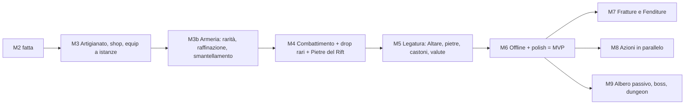

# Proposta: la fusione Melvor + Metin2 + Path of Exile

Stato: **PROPOSTA**, da approvare dall'utente. Nessun altro documento è ancora cambiato: se la proposta passa, il
Reviewer aggiorna `00_VISION.md`, `01_GDD.md`, `02_FORMULAS.md`, `04_DATA_SCHEMA.md`, `05_INTERFACES.md`,
`06_ROADMAP.md`, `07_TASKS.md` e `OPEN_QUESTIONS.md` come indicato nella sezione 6.
I numeri qui sono **valori di partenza** da confermare in `02_FORMULAS.md`: vanno rivisti dopo la prova di gioco (Q15).

## 1. Perché adesso

Oggi il design è quasi tutto Melvor: affissi casuali, potenziamento +N e gemme sono **fuori scope** in
`00_VISION.md`. M3 (artigianato, shop, equipaggiamento) è la milestone in cui si decide **com'è fatto un oggetto**.
Oggi un oggetto è un id impilabile nella bank. Affissi e +N richiedono invece **oggetti unici** (istanze). Se si
introducono dopo M3-M4, vanno rifatti Bank, Equipment, il resolver dell'artigianato, la borsa del bottino, il
salvataggio e la UI di tre pagine. Se si introducono ora, costano un modulo in più e qualche firma diversa.

## 2. Principi della fusione

1. **Il cuore resta idle (Melvor)**: azione → XP → livello, maestria, bank, offline di 12 ore. Ogni meccanica presa
   da Metin2 o PoE deve funzionare **senza il giocatore davanti** oppure essere una scelta breve fatta al rientro.
2. **Metin2 porta il "rischio e la voglia di potenziare"**: raffinazione +N con fallimento, pietre da distruggere,
   castoni. **PoE porta la "caccia al drop e la build"**: rarità, affissi a gradi, valute di crafting, mappe.
3. **Un solo sistema di modificatori**: affissi, +N, castoni e pietre sono **sorgenti di `ModifierService`**, e usano
   solo stat del registro (`stats.json`). Nessuna stat nuova senza effetto, formula e test.
4. **Clean room esteso a tutti e tre i giochi**: nessun nome, testo, tabella o asset di Metin2 o PoE (niente "Metin",
   "Pergamena della benedizione", "Orb of Chaos/Exalted", nomi di affissi o unici). Si prende l'**idea**, non la forma.
5. **Determinismo**: ogni tiro (rarità, affissi, raffinazione) usa l'`Rng` della sessione, così test e offline restano
   riproducibili.

## 3. Le meccaniche proposte

Priorità: **A** = nell'MVP (M3-M5), **B** = dopo l'MVP.

| # | Meccanica | Ispirazione | Priorità | Milestone |
|---|---|---|---|---|
| 3.1 | Oggetti unici (istanze) e Armeria | prerequisito tecnico | A | M3 |
| 3.2 | Rarità e affissi a gradi | PoE | A | M3 (artigianato), M4 (drop) |
| 3.3 | Raffinazione +0…+9 con fallimento | Metin2 | A | M3b |
| 3.4 | Smantellamento e filtro automatico | PoE (filtro del loot) | A | M3b |
| 3.5 | Pietre del Rift nelle aree | Metin2 (pietre da abbattere) | A | M4 |
| 3.6 | Castoni e pietre incastonabili | Metin2 + PoE (gemme) | A | M5 |
| 3.7 | Valute del Rift (crafting degli affissi) | PoE | A | M5 |
| 3.8 | Fenditure: le Fratture diventano "mappe" | PoE (mappe) | B | M7 |
| 3.9 | Albero passivo del combattimento | PoE (albero passivo) | B | M9 |
| 3.10 | Boss, dungeon a ondate, oggetti unici | Metin2 + PoE | B | M9 (già Q11) |
| 3.11 | Elementi e resistenze | Metin2 + PoE | B | dopo M9 |

### 3.1 Oggetti unici e Armeria (prerequisito)
- Gli oggetti di categoria `equipment` e `tool` **non stanno più nella bank**: ogni pezzo è un'**istanza** con
  `uid`, oggetto base (`base`, l'id di `ItemDef`), `rarity`, `ilvl`, `affixes`, `upgrade`, `sockets`.
- Nuovo modulo **Armeria** (`systems/armory/armory.gd`): contiene le istanze, ha una capienza propria
  (`armory.base_slots` 40 + stat `armory_slots` dallo shop) e il blocco per pezzo. La bank resta come oggi, impilabile,
  per materiali, cibo, infusioni, pietre e valute.
- L'equipaggiamento indossato punta a un `uid`, non a un id. Equipaggiare sposta l'istanza da Armeria a slot e viceversa
  (`armory_full` al posto di `bank_full`).
- I modificatori dello slot (`equipment:<slot>`) diventano: modificatori base × raffinazione (F-63) + affissi + castoni.
- Il resolver dell'artigianato e la borsa del bottino, quando l'output è un equipaggiamento, **creano un'istanza**
  nell'Armeria. Armeria piena → come la bank piena: il ciclo non conta e l'azione si ferma (`armory_full`).

### 3.2 Rarità e affissi (PoE)
- Rarità: **comune** (0 affissi), **magico** (1-2: al massimo 1 prefisso e 1 suffisso), **raro** (3-4: al massimo
  2 prefissi e 2 suffissi). Gli **unici** sono di priorità B.
- Ogni affisso ha **gradi** (tier) sbloccati dal livello dell'oggetto `ilvl`: `ilvl` = livello della ricetta per
  l'artigianato, livello del mostro per i drop.
- Gli affissi usano **solo stat esistenti**:
  - armi: `accuracy_pct`, `power_pct`, `power_bonus`, `attack_interval_pct`;
  - armature: `evasion_pct`, `evasion_bonus`, `damage_reduction`, `max_hp_flat`, `food_healing_pct`;
  - gioielli (`neck`, `ring`): `gold_drop_pct`, `skill_xp_pct`, `max_hp_flat`;
  - attrezzi: `skill_interval_pct`, `double_item_chance`, `rift_shard_chance`, `mastery_xp_pct`, con scope della skill.
- Gli anelli e gli amuleti oggi non hanno una fonte. Proposta: si trovano **solo come drop** (dai mostri e dalle Pietre
  del Rift), così i drop hanno un valore che l'artigianato non copre.
- La rarità dei pezzi forgiati cresce con il livello di maestria della ricetta: la maestria di Melvor diventa
  "più probabilità di forgiare un raro", un legame forte tra i due modelli.

### 3.3 Raffinazione +N (Metin2)
- Comando istantaneo dalla pagina dell'Armeria (non un'azione a tempo): costa oro e materiali, tira la riuscita (F-64).
- Riuscita: `upgrade + 1`. Fallimento: i materiali sono persi; **da +4 in su il pezzo scende di un livello**. Il pezzo
  **non si distrugge mai**: in un idle la perdita totale di un oggetto è troppo punitiva.
- **Sigillo di salvaguardia** (oggetto, nome provvisorio originale): se è nella bank e il giocatore lo attiva, un
  fallimento non fa scendere il livello. Si produce con la Legatura del Rift o si compra nello shop.
- Effetto: moltiplica **solo i modificatori base** del pezzo, non gli affissi (F-63).
- Nuova stat `upgrade_success_pct` (fonti: nodi di maestria della Forgiatura, un'infusione).

### 3.4 Smantellamento e filtro (PoE)
- Smantellare un pezzo restituisce materiali del suo grado e frammenti del Rift secondo la rarità (F-66).
- **Filtro automatico** per slot di gioco: "smantella automaticamente comuni / magici sotto il grado X". Necessario
  per l'offline: 12 ore di combattimento producono centinaia di pezzi, e senza filtro l'Armeria si riempie e il
  combattimento si fermerebbe a ogni drop.

### 3.5 Pietre del Rift (Metin2)
- In ogni area, dopo ogni uccisione c'è una probabilità che appaia una **Pietra del Rift** (F-65): un bersaglio con
  molti PV che non attacca ma lancia un **impulso** periodico di danno, contro cui contano cibo e riduzione del danno.
- È il cuore narrativo del gioco: le Pietre del Rift incrinate sono già il pitch di `00_VISION.md`.
- Bottino: tanti frammenti del Rift, materiali di raffinazione, possibilità di **pietre incastonabili** (3.6) e di
  gioielli rari. È la fonte principale di frammenti, che oggi arrivano solo con lo 0,5-3%.
- Tecnicamente è un mostro con `kind: "riftstone"` in `monsters.json`, con i propri campi (impulso, regola di comparsa).

### 3.6 Castoni e pietre incastonabili (Metin2 + PoE)
- Ogni pezzo ha 0-3 **castoni**: 1 dal raro, +1 a +5 e +1 a +9 di raffinazione (F-67).
- Le **pietre** (nuova categoria di oggetto `stone`, impilabili nella bank) danno modificatori quando sono incastonate.
  Si ottengono dalle Pietre del Rift e si migliorano con la Legatura del Rift (3 pietre di grado n → 1 di grado n+1).
- Togliere una pietra la distrugge, come per le infusioni dell'Altare (coerenza con Q8).
- Così l'Altare resta il potenziamento **globale** (infusioni) e i castoni quello **per pezzo** (pietre).

### 3.7 Valute del Rift (PoE)
Tre oggetti prodotti dalla Legatura del Rift con frammenti e materiali (nomi provvisori, originali):

| Id provvisorio | Effetto |
|---|---|
| `rift_tincture` | comune → magico (tira gli affissi) |
| `rift_resin` | magico → raro (aggiunge affissi fino a 3-4) |
| `rift_flux` | ritira tutti gli affissi mantenendo la rarità |

Aggiunte facoltative (B): blocco di un affisso, aggiunta di un castone. Il crafting avviene dalla pagina dell'Armeria,
con tiri deterministici.

### 3.8-3.11 Dopo l'MVP (B)
- **Fenditure (M7)**: le Fratture del Rift diventano anche oggetti consumabili ("chiavi di frattura") con 1-3 modificatori
  sui mostri (più PV, più danno) e bonus su quantità e rarità del bottino. È la versione idle delle mappe di PoE.
- **Albero passivo del combattimento (M9)**: un punto ogni N livelli totali di combattimento, con nodi che usano il
  codice e la UI della maestria a nodi già pronti in M2.
- **Boss, dungeon a ondate, unici**: restano in M9 (Q11). **Elementi e resistenze**: dopo, perché richiedono un secondo
  asse di danno accanto al triangolo e molte stat nuove.

## 4. Formule proposte (da portare in `02_FORMULAS.md`)

Gli id F-60…F-67 sono liberi. Ogni esempio diventerà un test.

**F-60 Rarità.** Si tira `r` in `[0, 100)` e si confronta con le soglie della fonte, moltiplicate per
`(1 + item_rarity_pct/100)`:
- drop da mostro: raro 2%, magico 18%; drop da Pietra del Rift: raro 10%, magico 40%;
- artigianato: raro `1 + 0,05 × M`, magico `10 + 0,3 × M`, con `M` = livello di maestria della ricetta.

Esempio: maestria 50, nessun bonus → raro 3,5%, magico 25%, comune 71,5%.

**F-61 Numero di affissi.** Magico: 1 (70%) o 2 (30%). Raro: 3 (65%) o 4 (35%). Prefissi e suffissi si alternano
fino ai massimi di 3.2.

**F-62 Grado e valore.** Tra i gradi con `min_ilvl ≤ ilvl` dell'affisso si sceglie pesando per `weight`; il valore
è un intero uniforme in `[min, max]` del grado. Lo stesso affisso non compare due volte sullo stesso pezzo.

**F-63 Effetto della raffinazione.** `valore = floor(base × (1 + upgrade.per_level_pct/100 × N))`, con
`per_level_pct` = 10. Esempio: lama T4 (`power_bonus` 24) a +7 → `floor(24 × 1,7)` = 40.

**F-64 Raffinazione.** Riuscita da `N` a `N+1`: `[95, 90, 85, 75, 65, 55, 45, 35, 25]` (indice `N`) ×
`(1 + upgrade_success_pct/100)`, massimo 95. Costo: oro `= valore del pezzo × 2^N`; `N+1` lingotti del grado del
pezzo; da +6 anche `N−4` frammenti del Rift. Fallimento da `N ≥ 4`: il pezzo scende a `N−1`, salvo Sigillo.

**F-65 Comparsa della Pietra del Rift.** Dopo ogni uccisione nell'area: `riftstone.spawn_chance_pct` = 4%, garantita
dopo 40 uccisioni senza pietra (contatore salvato). PV = 6 × PV del mostro più forte dell'area. Impulso ogni
4000 ms: `ceil(8% × PV massimi del giocatore)`, ridotto da `damage_reduction` (F-25).

**F-66 Smantellamento.** Comune: 1 lingotto (o legno) del grado. Magico: 2 lingotti + 1 frammento. Raro: 3 lingotti +
3 frammenti. Raffinazione: +1 frammento per ogni livello oltre +4.

**F-67 Castoni.** `castoni = (rarità = raro ? 1 : 0) + (N ≥ 5 ? 1 : 0) + (N ≥ 9 ? 1 : 0)`.

Nuove stat per il registro (§11): `item_rarity_pct` (0-500, F-60), `upgrade_success_pct` (0-100, F-64),
`armory_slots` (0-1000, capienza dell'Armeria).

## 5. Impatto tecnico

### 5.1 Moduli
| Modulo | Cambio |
|---|---|
| `systems/armory/` **nuovo** | istanze, capienza, blocco, smantellamento, filtro, raffinazione, valute; dipendenze: data, events, modifiers, rng, bank, wallet |
| `systems/items/item_roller.gd` **nuovo** | F-60…F-62: crea un'istanza da (base, ilvl, fonte); logica pura, testabile |
| `systems/equipment/equipment.gd` | gli slot tengono un `uid`; `rebuild_modifiers` somma base × F-63 + affissi + pietre |
| `systems/actions/artisan_resolver.gd` (M3-01) | output di tipo equipaggiamento → `ItemRoller` + Armeria; nuovo motivo di stop `armory_full` |
| `systems/combat/` (M4) | drop di equipaggiamento con rarità; Pietra del Rift come terzo stato (`RIFTSTONE`) accanto a `FIGHTING` e `RESPAWNING` |
| `systems/rift/` (M5) | ricette di pietre e valute (dati); i castoni li gestisce l'Armeria |
| `systems/bank/bank.gd` | **nessun cambio di firma**: rifiuta solo le categorie `equipment`/`tool` (vanno nell'Armeria) |
| `core/data/` | nuove Def: `AffixDef`, `StoneDef` (dentro `ItemDef`), campi `riftstone` in `MonsterDef`; regole del validatore |

`GameSession` resta solo composizione: registra l'Armeria tra Bank ed Equipment nell'ordine delle dipendenze.

### 5.2 Dati (`04_DATA_SCHEMA.md`)
- **Nuovo** `data/items/affixes.json`:
  ```json
  {"affixes": [{"id": "of_the_ember_edge", "name": "del Filo di Brace", "kind": "suffix",
                "slots": ["weapon"], "stat": "power_pct",
                "tiers": [{"min_ilvl": 1, "min": 3, "max": 6, "weight": 100},
                          {"min_ilvl": 30, "min": 7, "max": 12, "weight": 60},
                          {"min_ilvl": 60, "min": 13, "max": 20, "weight": 25}]}]}
  ```
- `items/*.json`: categoria nuova `stone` (`{"stone": {"modifiers": [...], "slots": [...]}}`) e categoria `currency`
  per le valute; i gioielli entrano in `equipment.json`.
- `monsters.json`: `kind` (`normal`/`riftstone`), campi `pulse_ms`, `pulse_pct` e tabella dei drop di rarità.
- `balance.json`: `armory.*`, `upgrade.*`, `rarity.*` (soglie di F-60), `riftstone.*`.

### 5.3 Salvataggio (`05_INTERFACES.md` §6)
Un modulo in più, nessuna migrazione: le chiavi assenti valgono "partita nuova" e oggi non esistono salvataggi con
equipaggiamento.
```json
"armory": {"next_uid": 58, "filter": {"auto_salvage": ["common"], "below_tier": 3},
           "items": [{"uid": 41, "base": "emberbronze_blade", "rarity": "rare", "ilvl": 30, "upgrade": 5,
                      "locked": true,
                      "affixes": [{"id": "of_the_ember_edge", "tier": 1, "value": 9}],
                      "sockets": ["stone_ember_2", ""]}]},
"equipment": {"slots": {"weapon": 41}, "food": "seared_brookfin", "stance": "balanced"},
"combat": {"…": "…", "riftstone_pity": 17}
```

### 5.4 Segnali e UI
- Segnali nuovi: `armory_changed(uid, change)`, `item_upgraded(uid, success, new_level)`, `item_salvaged(uid, yields)`,
  `riftstone_appeared(area)`.
- Pagina **Armeria** (griglia dei pezzi con il colore della rarità, pannello del pezzo con affissi, raffinazione,
  castoni, valute, smantellamento, filtro).
- Il tooltip dell'oggetto mostra rarità, affissi con grado, +N e castoni. Il riepilogo offline aggiunge pezzi trovati,
  smantellati e Pietre del Rift abbattute.

## 6. Modifiche ai documenti e alla roadmap

### 6.1 Documenti
| Documento | Modifica |
|---|---|
| `00_VISION.md` | pitch con i tre modelli; pilastro nuovo "Caccia e potenziamento"; via dal fuori scope: affissi, gemme (come pietre), +N; tabella delle differenze per Metin2 e PoE |
| `01_GDD.md` | §7 Bank (solo impilabili); §9 Equipaggiamento (istanze); sezioni nuove: 19 Armeria, 20 Rarità e affissi, 21 Raffinazione, 22 Pietre del Rift, 23 Castoni e valute |
| `02_FORMULAS.md` | F-60…F-67, tabelle di affissi e pietre, 3 stat nuove nel registro |
| `04_DATA_SCHEMA.md` | `affixes.json`, categorie `stone`/`currency`, campi dei mostri |
| `05_INTERFACES.md` | Armeria, ItemRoller, Equipment con `uid`, segnali nuovi, salvataggio |
| `OPEN_QUESTIONS.md` | Q27-Q33 (sezione 7) |

### 6.2 Roadmap


| Milestone | Task cambiati o nuovi |
|---|---|
| M3 | **M3-03** Equipment con `uid` (cambia l'accettazione); **M3-03b nuovo** Armeria minima (istanze, capienza, equip/unequip, solo pezzi comuni); M3-01 scrive gli equipaggiamenti nell'Armeria; M3-07 pagina equipaggiamento legge dall'Armeria |
| M3b **nuova** | ItemRoller (F-60…F-62) · Raffinazione (F-63, F-64) · Smantellamento e filtro (F-66) · Dati degli affissi · Pagina Armeria · Test · Integrazione. Stima: simile a M2 |
| M4 | M4-02/M4-03: drop con rarità, Pietra del Rift (F-65); M4-04: gioielli, affissi dei gioielli, dati delle pietre nelle aree; M4-05: indicatore della Pietra |
| M5 | M5-02: ricette di pietre e valute; **nuovo** castoni (F-67) e uso delle valute nell'Armeria |
| M6 | M6-01: l'offline usa il filtro di smantellamento; il riepilogo conta pezzi e pietre |

Il costo totale stimato è di circa una milestone in più (M3b) più un 20-30% su M4 e M5. In cambio il gioco ottiene il
suo secondo e terzo pilastro, invece di essere un Melvor con altri nomi.

## 7. Domande aperte nuove (con default)

| # | Domanda | Default proposto |
|---|---|---|
| Q27 | Il pezzo può distruggersi nella raffinazione (come in Metin2)? | No: scende di un livello da +4, mai distrutto |
| Q28 | Livello massimo di raffinazione | +9 |
| Q29 | Unici (oggetti con nome e affissi fissi) nell'MVP? | No, in M9 |
| Q30 | Anelli e amuleti forgiabili? | No: solo drop |
| Q31 | La raffinazione è istantanea o un'azione a tempo della Forgiatura? | Istantanea (un comando); a tempo renderebbe la scelta troppo lenta |
| Q32 | Gli attrezzi di raccolta hanno rarità e affissi? | Sì (affissi di raccolta): legano la "caccia al drop" anche alle skill idle |
| Q33 | Capienza iniziale dell'Armeria | 40, più caselle comprabili nello shop (`armory_slots`) |

## 8. Cosa serve per partire
1. L'utente approva (anche in parte: ogni riga della tabella in 3 si può accettare o rinviare) e risponde a Q27-Q33,
   oppure accetta i default.
2. Il Reviewer aggiorna i documenti della sezione 6.1 e `07_TASKS.md`.
3. M3 parte con il modello a istanze già nel contratto.
