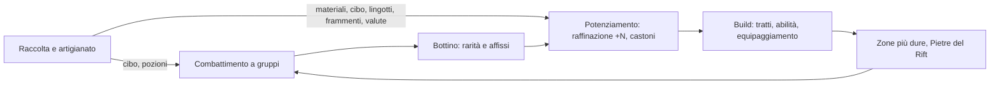
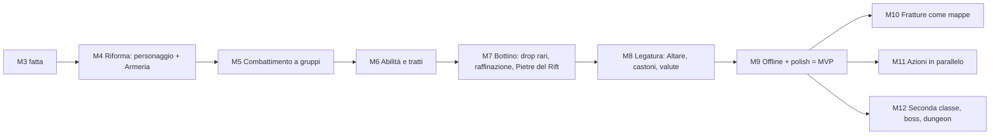

# Visione v2: combattimento al centro (Melvor + Metin2 + Path of Exile)

Stato: **APPROVATA dall'utente** (decisioni D1-D5). Sostituisce la direzione di `00_VISION.md` da M4 in poi.
M0-M3 restano valide: raccolta, artigianato, maestria, bank, shop, salvataggio, offline e modificatori si tengono.
Questo documento è la **fonte** per la riforma dei documenti (task R-00, §9): il Reviewer ne riporta il contenuto nei
documenti canonici e da quel momento valgono quelli. I numeri sono valori di partenza: le formule definitive le fissa
R-00 in `02_FORMULAS.md`, con esempi che diventano test.

## 1. Decisioni dell'utente

| # | Decisione |
|---|---|
| D1 | Il **combattimento è il cuore del gioco**; raccolta e artigianato sono attività di supporto in stile Melvor |
| D2 | **Classi** sì, ma nell'MVP **una sola**; le altre arrivano dopo, solo con dati e contenuti nuovi |
| D3 | Un **livello del personaggio** unico sostituisce le 5 skill di combattimento (Lama, Mira, Arcano, Vitalità, Guardia) |
| D4 | Nessun attributo da distribuire: **tratti passivi** sbloccati con il livello del personaggio che **cambiano il modo di combattere** (idea ispirata ai tratti a slot di No Rest for the Wicked 1.0; forma, nomi e numeri originali) |
| D5 | **Gruppi di mostri** al posto del duello; raccolta e artigianato tengono i **livelli di skill alla Melvor** |

Clean room esteso: nessun nome, testo, tabella o asset di Melvor, Metin2, Path of Exile o No Rest for the Wicked.
Si prendono le **idee**, non la forma (niente "Insight", "Cerim", "Metin", nomi di orb, di classi o di tratti altrui).

## 2. Il ciclo del gioco

- **Ciclo principale** (Metin2 + PoE): combatti, trovi bottino, potenzi, cambi build, sali di zona.
- **Ciclo di supporto** (Melvor): le 6 skill fatte in M1-M3 più la Legatura del Rift. Ogni loro prodotto serve al
  combattimento o al potenziamento; nessuna skill è fine a se stessa.
- **Idle**: il combattimento è automatico. Le decisioni del giocatore sono build (tratti, abilità, equipaggiamento),
  dove combattere, cosa tenere e cosa potenziare.

## 3. Il personaggio

### 3.1 Classe
- Una classe è un file di dati (`data/classes/<id>.json`): nome, descrizione, abilità disponibili, tratti disponibili,
  stili d'arma ammessi. Il motore non conosce le classi per nome.
- **MVP: una classe**, "Custode del Rift" (nome provvisorio), che usa **tutti e tre gli stili d'arma** già forgiati in
  M3 (lama, arco, bastone arcano). Così Forgiatura e Intaglio restano utili e le classi future potranno specializzarsi.
- La classe si sceglie alla creazione della partita (nell'MVP la scelta è fissa) ed è salvata nello slot.

### 3.2 Livello del personaggio
- Un solo livello (1-99, curva della tabella F-01 con parametri propri `character_curve`), con XP **per uccisione**
  (campo `xp` del mostro, che passa da `skill_xp_pct`).
- Dal livello vengono i valori base: PV massimi, precisione, danno, evasione (formula F-70, lineare nel livello).
  Il resto arriva dall'equipaggiamento (affissi, raffinazione, castoni), dai tratti e dall'Altare.
- I requisiti degli equipaggiamenti passano da `{"blade": n}` / `{"guard": n}` a `{"character": n}`.
- La **stance** sparisce: l'XP va tutta al personaggio.

### 3.3 Tratti (D4)
- Ogni tratto si sblocca a un livello del personaggio (`unlock_level` nel file della classe).
- Il giocatore ne equipaggia **pochi**: **slot** che si aprono ai livelli `traits.slot_levels` (proposta: 1, 10, 25, 50).
  Tutti gli slot sono uguali: niente categorie, per tenere la scelta semplice.
- I tratti si cambiano liberamente **fuori dal combattimento o tra un incontro e l'altro**, mai a metà incontro.
- Un tratto è un insieme di **effetti tipizzati** (agganci agli eventi del combattimento, §4.4) più, se serve,
  modificatori di `ModifierService`. Un tratto solo di modificatori è vietato: sarebbe una stat, non un tratto.
- Tratti dell'MVP: **12**, costruiti su circa 8 tipi di effetto. Esempi:

| Tratto (provvisorio) | Effetto | Tipo di effetto |
|---|---|---|
| Fendente a catena | ogni 3° attacco colpisce tutti i nemici | `every_nth_attack_all` |
| Sete del Rift | uccidere un nemico riduce del 50% il timer del prossimo attacco | `on_kill_timer_cut` |
| Ultima trincea | sotto il 30% di PV il danno è ×2, ma il cibo automatico non scatta | `low_hp_damage_mult` |
| Pelle di pietra | evasione a 0, riduzione del danno ×2 | `stat_trade` |
| Cacciatore di deboli | il bersaglio è sempre il nemico con meno PV | `target_rule` |
| Lama riflessa | il 20% del danno subito torna all'attaccante | `reflect_pct` |
| Bevitore di vita | il 5% del danno inflitto cura | `leech_pct` |
| Primo sangue | all'inizio di ogni incontro il primo attacco parte subito | `opening_strike` |

### 3.4 Abilità attive
- La classe ha **4 abilità**; se ne equipaggiano **2** (la 3ª slot al livello 30, proposta). Partono **da sole** quando
  il tempo di ricarica scade e c'è un bersaglio valido.
- Tipi dell'MVP: colpo pesante su un bersaglio, colpo ad area (tutti o N nemici), cura o scudo, potenziamento
  temporaneo.
- Un'abilità può richiedere uno stile d'arma (`weapon_styles`): con l'arco si usano le abilità da arco, ecc.
- Dopo l'MVP: **supporti** da incastonare nelle abilità (idea delle gemme di supporto di PoE).

## 4. Combattimento a gruppi (D5)

### 4.1 Modello
- Un'**area** ha una lista di **gruppi** (`packs`) pesati; ogni gruppo è una lista di 1-6 mostri.
- Un **incontro** = un gruppo pescato. Ogni nemico ha PV, timer d'attacco e posizione nella fila (0..n-1).
- Il giocatore ha il timer dell'attacco base, i timer delle abilità e lo stato dei tratti.
- Stati: `IDLE` → `ENCOUNTER` ⇄ `BETWEEN` (attesa `combat.respawn_ms`) → `IDLE`; `RIFTSTONE` è un incontro speciale (§5.4).

### 4.2 Risoluzione deterministica
- A ogni evento si risolve chi ha il timer scaduto, in **ordine fisso**: giocatore (attacco base, poi abilità in ordine
  di slot), poi i nemici per posizione. A parità di seme dell'`Rng` lo stesso incontro dà sempre lo stesso esito.
- **Bersaglio** del giocatore: regola `first` (il primo vivo della fila), cambiabile da un tratto (`target_rule`).
  Le abilità ad area colpiscono tutti o i primi N.
- Tutti i nemici vivi attaccano il giocatore: più nemici significa più pressione, quindi difesa e cura contano davvero.
- Precisione e danno: formule già scritte per M4 (F-20…F-25, rapporto `AR/(AR+ER)` limitato al 5-95%), con i valori
  base da F-70 invece che dalle skill. Il **triangolo** Lama > Arcano > Mira > Lama resta tra lo stile dell'arma del
  giocatore e lo stile del mostro.
- Fine incontro: tutti i nemici morti; il bottino di ognuno va nella borsa; poi `BETWEEN` e un nuovo gruppo.
- Morte: come oggi (si perde la borsa del bottino, si torna a `IDLE` con i PV pieni).

### 4.3 Motore a eventi (prestazioni e offline)
- Il motore **non** simula ogni passo da 100 ms: calcola il prossimo timer che scade e **salta lì**. `advance(delta_ms)`
  consuma eventi finché il tempo basta, poi conserva il resto nei timer.
- Il risultato è identico a quello passo per passo: un test lo confronta (stesso seme, `advance(1000)` contro dieci
  `advance(100)`, come già richiesto dal GDD §2).
- Obiettivo: 12 ore di offline con gruppi da 6 in **meno di 10 s** (test di prestazione in M9).

### 4.4 Agganci per i tratti
Eventi esposti dal motore: `on_encounter_start`, `on_before_attack`, `on_hit`, `on_kill`, `on_damaged`,
`on_low_hp`, `choose_target`. Ogni tipo di effetto è una piccola classe (`systems/combat/effects/<tipo>.gd`) che
reagisce a uno o più eventi con i parametri del dato. Un tipo nuovo = una classe nuova + i suoi test; un tratto nuovo
= solo dati.

### 4.5 Interfaccia
Pagina del combattimento: carta del giocatore (PV, timer, abilità con ricarica, tratti attivi), una carta per nemico
(PV, timer, evidenziatore sul bersaglio), numeri del danno, borsa del bottino, scelta di area. Nessuna animazione di
posizione.

### 4.6 Strumento di bilanciamento
`tools/sim_combat.gd`: simula N ore di combattimento in headless (classe, livello, equipaggiamento, tratti, area) e
stampa uccisioni/ora, morti, oro/ora, XP/ora, cibo consumato. Si usa a ogni cambio dei dati di combattimento.

## 5. Bottino e potenziamento

### 5.1 Armeria (oggetti unici)
- `equipment` e `tool` non stanno più nella bank: ogni pezzo è un'**istanza** (`uid`, `base`, `rarity`, `ilvl`,
  `affixes`, `upgrade`, `sockets`, `locked`) nell'**Armeria** (`systems/armory/armory.gd`), con capienza propria
  (`armory.base_slots` 40 + stat `armory_slots`).
- Gli slot indossati puntano a un `uid`. Artigianato, shop e drop **creano istanze**. Armeria piena → il ciclo non
  conta e l'azione si ferma (`armory_full`), come la bank piena oggi.
- La bank resta impilabile: materiali, cibo, infusioni, pietre, valute.

### 5.2 Rarità e affissi (PoE)
- Comune (0 affissi), magico (1-2), raro (3-4); unici dopo l'MVP.
- Affissi a **gradi** sbloccati da `ilvl` (livello della ricetta o del mostro), solo su **stat del registro**.
- Rarità nell'artigianato: cresce con la maestria della ricetta (lega la maestria Melvor al bottino). Rarità nei drop:
  soglie per fonte, × `(1 + item_rarity_pct/100)`.
- Anelli e amuleti: **solo da drop**.

### 5.3 Raffinazione +0…+9 (Metin2)
Comando istantaneo dall'Armeria: costa oro, lingotti del grado e, da +6, frammenti del Rift. Probabilità di riuscita
decrescente (95% → 25%), × `(1 + upgrade_success_pct/100)`. Fallimento: materiali persi; da +4 il pezzo scende di un
livello; **mai distrutto**. Il Sigillo di salvaguardia evita la discesa. Moltiplica solo i modificatori base del pezzo.

### 5.4 Pietre del Rift (Metin2)
Incontro speciale: dopo ogni uccisione c'è una probabilità (con garanzia dopo N uccisioni) che appaia una Pietra del
Rift con molti PV che non attacca ma lancia un impulso periodico di danno, e magari evoca un gruppo. Bottino:
frammenti del Rift in quantità, materiali di raffinazione, pietre da incastonare, gioielli.

### 5.5 Smantellamento e filtro
Smantellare restituisce materiali e frammenti secondo grado e rarità. **Filtro automatico** per slot di gioco
(rarità e grado minimi da tenere): obbligatorio per l'offline.

### 5.6 Castoni e valute del Rift (M8)
Castoni sui pezzi (da rarità e raffinazione); pietre incastonabili (categoria `stone`) da Pietre del Rift e
Legatura; tre valute (comune → magico, magico → raro, ritiro degli affissi) prodotte dalla Legatura del Rift.

## 6. Cosa cambia nel lavoro già fatto (M0-M3)

| Area | Cambio |
|---|---|
| `data/skills/skills.json` | via le 5 skill `combat`; restano 6 skill di supporto + `riftbinding` |
| `systems/character/` **nuovo** | livello, XP per uccisione, classe, tratti equipaggiati, abilità equipaggiate; salvataggio `character` |
| `systems/equipment/equipment.gd` | slot con `uid`; stance tolta; requisiti `character` |
| `systems/armory/` **nuovo** | istanze, capienza, blocco, raffinazione, smantellamento, filtro |
| `systems/items/item_roller.gd` **nuovo** | rarità e affissi, logica pura |
| `systems/actions/artisan_resolver.gd` | output `equipment`/`tool` → Armeria; stop `armory_full` |
| `systems/shop/shop.gd` | gli attrezzi comprati vanno nell'Armeria |
| `systems/bank/bank.gd` | rifiuta `equipment`/`tool` (nessuna firma cambiata) |
| `data/items/equipment.json`, `tools.json` | requisiti `{"character": n}` per gli equipaggiamenti; gli attrezzi tengono il requisito della propria skill |
| `data/config/stats.json` | nuove stat `item_rarity_pct`, `upgrade_success_pct`, `armory_slots`; stat di combattimento ricontrollate |
| UI | pagine Equipaggiamento, Bank e Shop leggono l'Armeria; pagina Armeria nuova; sidebar senza le 5 skill di combattimento |
| Salvataggio | `format_version` 2; moduli nuovi `character`, `armory`; nessun giocatore reale: niente migrazione, un save v1 non si carica (slot "versione non supportata") |

## 7. MVP e roadmap da M4

| Milestone | Contenuto | Giocabile |
|---|---|---|
| **M4 Riforma** | R-00 documenti; modulo `character` (livello, classe unica, senza tratti); 5 skill di combattimento tolte; Armeria e `uid` negli slot; ItemRoller con rarità e affissi per i pezzi forgiati; UI adeguata | il gioco di M3 con pezzi forgiati unici e rari, Armeria, pagina del personaggio |
| **M5 Combattimento a gruppi** | formule (F-20…F-25 su base F-70); motore a eventi; incontri e gruppi; borsa del bottino, cibo automatico, morte; 4 aree, ~12 mostri, gruppi; pagina del combattimento; `tools/sim_combat.gd` | combattimento automatico a gruppi con attacco base, XP del personaggio, bottino |
| **M6 Abilità e tratti** | agganci del motore; ~8 tipi di effetto; 12 tratti e 4 abilità della classe; slot; UI di scelta | build vere: i tratti cambiano come si combatte |
| **M7 Bottino** | drop con rarità; gioielli; raffinazione; smantellamento e filtro; Pietre del Rift | caccia al drop e potenziamento |
| **M8 Legatura del Rift** | Altare (come previsto), castoni, pietre, valute | crafting degli affissi |
| **M9 Offline + polish** | come la vecchia M6, con offline del motore a eventi e filtro | **MVP** |

Fuori dall'MVP: Fratture come mappe con modificatori (M10), corsie parallele (M11), seconda classe, supporti delle
abilità, boss, dungeon a ondate, unici, elementi e resistenze (M12+).

I task M4-xx…M8-xx attuali di `07_TASKS.md` sono **superati**: R-00 li sostituisce con i nuovi (le parti ancora valide,
come le formule di precisione e danno, l'Altare e i suggerimenti, si riusano nei task nuovi).

## 8. Domande aperte nuove (vale il default finché l'utente non risponde)

| # | Domanda | Default |
|---|---|---|
| Q27 | La raffinazione può distruggere un pezzo? | No: da +4 scende di un livello |
| Q28 | Raffinazione massima | +9 |
| Q29 | Unici nell'MVP? | No (M12+) |
| Q30 | Anelli e amuleti forgiabili? | No, solo drop |
| Q31 | Raffinazione istantanea o azione a tempo? | Istantanea |
| Q32 | Attrezzi di raccolta con rarità e affissi? | Sì, affissi di raccolta |
| Q33 | Capienza iniziale dell'Armeria | 40 + caselle nello shop |
| Q34 | Livello massimo del personaggio | 99, curva `character_curve` |
| Q35 | Livelli di apertura degli slot dei tratti | 1, 10, 25, 50 |
| Q36 | Slot delle abilità | 2, il 3° al livello 30 |
| Q37 | La classe unica usa tutti e tre gli stili d'arma? | Sì, finché non arrivano le altre classi |
| Q38 | Dimensione dei gruppi | 1-6, più grandi nelle aree alte |

Q6 (munizioni e rune), Q9 (stance) e Q10 (abilità) di `OPEN_QUESTIONS.md` si chiudono: niente munizioni, stance
tolta, abilità sì (§3.4).

## 9. Task R-00: riforma dei documenti (prima di qualunque codice di M4)

- **Ruolo** REV · **Ownership** `docs/**`, `CLAUDE.md` (solo righe di intro e stato).
- **Descrizione** Riportare questo documento nei documenti canonici, una sezione alla volta:
  `00_VISION.md` (pitch, pilastri, 12 skill → personaggio + 7 skill di supporto, differenze, fuori scope);
  `01_GDD.md` (§3 skill di supporto, §9 equipaggiamento con `uid`, §10 combattimento riscritto, sezioni nuove:
  personaggio, tratti e abilità, Armeria, rarità e affissi, raffinazione, Pietre del Rift, smantellamento);
  `02_FORMULAS.md` (F-70 e seguenti con esempi, revisione di F-20…F-34, registro delle stat);
  `04_DATA_SCHEMA.md` (classi, tratti, abilità, gruppi delle aree, affissi, Armeria);
  `05_INTERFACES.md` (CharacterSystem, Armory, ItemRoller, CombatEngine a eventi, segnali, save v2);
  `06_ROADMAP.md` (§7); `07_TASKS.md` (task nuovi di M4-M6 in dettaglio, M7-M9 in sintesi);
  `OPEN_QUESTIONS.md` (Q27-Q38, chiusura di Q6, Q9, Q10); `DECISIONS_LOG.md` (D1-D5); `STATUS.md`.
- **Accettazione** nessuna contraddizione tra i documenti; ogni formula nuova ha esempi; ogni stat nuova ha riga nel
  registro; `07_TASKS.md` di M4 completo (ownership, letture per sezione, accettazione, test).
- **Stop** dopo R-00 per l'OK dell'utente, prima di M4-01.
